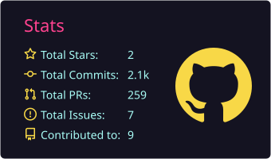
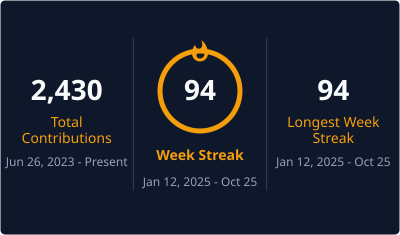

<h1 align="center">Olá Mundo 👋, eu sou o Leonardo Nunes</h1>
<h3 align="center">Desenvolvedor Full Stack com foco em TypeScript, Node.js e React</h3>

-  💼 Desenvolvedor Full Stack Jr. na MigraCode, atuando com monitoramento industrial em tempo real, integrações e agentes de IA. Também desenvolvo sites e aplicações como freelancer.
-  🎓 Formado em Ciência e Tecnologia pela UFSB e em Análise e Desenvolvimento de Sistemas pela Uninter.
-  🌱 Atualmente estudando System Design e aprofundando meus conhecimentos em harnesses e orquestração de agentes de IA.
-  📍 Atualmente moro em Valença, Bahia.

🙋‍♂️ Fora do código, gosto de [filmes](https://letterboxd.com/leonunes/), [livros](https://www.skoob.com.br/usuario/1639942) e [jogos](https://psnprofiles.com/Juha_bach7), e me interesso por ciência e economia.

<h3 align="left">Onde me encontrar:</h3>

🌐 [Conheça meu portfólio e os projetos em destaque](https://dev-leonunes-portfolio.vercel.app/)

<h3 align="left">Linguagens e ferramentas:</h3>
<h4 align="left">Stack principal:</h4>

  

<h4 align="left">Outras tecnologias:</h4>

  

## 🔥 Github Stats

